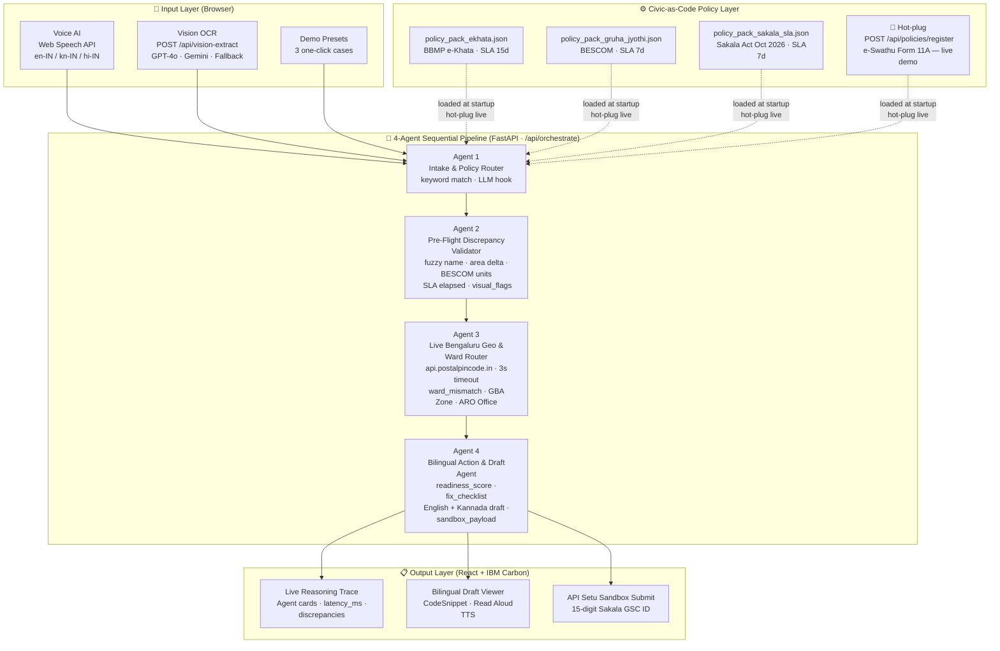

# SevaSync BLR — Speak. Scan. Solve.

> **IBM Bobathon 2026 · Track 01 Agentic AI**
>
> An agentic AI civic co-pilot that lets any Bengaluru citizen speak a complaint in English, Kannada, or Kanglish, scan a government document with Vision OCR, and receive a fully pre-audited, bilingual, Sakala-compliant application — powered by a live 4-agent reasoning pipeline and hot-pluggable JSON Policy Packs.

---

## Architecture — Speak → Scan → Solve



---

## Data Transparency: Real vs. Sandboxed

| Data / API | Real or Sandbox? | Why |
|---|---|---|
| **BBMP ward boundaries & GBA zones** | ✅ Real | `bengaluru_wards_zones.json` — 21 wards sourced from BBMP Revenue Manual 2024 with actual ward numbers, ARO office names, and GBA zone assignments |
| **Sakala SLA rules** | ✅ Real | Policy packs encode the actual statutory SLA days from Karnataka Sakala Services Act 2011 and the Oct 2026 amendment G.O. DPAR 56 SAK 2026 |
| **BESCOM Gruha Jyothi rules** | ✅ Real | 200-unit ceiling from G.O. DE 48 EEB 2023; numeric RR number requirement from BESCOM Consumer Circular BESCOM/CS/2022/107 |
| **PIN → Locality lookup** | ✅ Live API | `geo.py` calls `api.postalpincode.in` (3 s timeout) for real India Post locality data; gracefully falls back to `bengaluru_wards_zones.json` if the API is unreachable |
| **Citizen PII** (names, Aadhaar last-4, phone) | 🔒 Anonymized | All demo cases use fictitious but structurally authentic data (`R. Kumar`, `Kavitha Reddy`, `Suresh Babu`) — compliant with DPDP Act 2023 |
| **Government portal writes** (BBMP, BESCOM, Sakala) | 🧪 API Setu Sandbox | `POST /api/sandbox/submit` calls the API Setu sandbox adapter — no real government records are modified. Returns a realistic 15-digit GSC ID (`GSC2026BLR` + 6 digits) |
| **Vision OCR — LLM** | ⚡ Key-conditional | `vision.py` uses GPT-4o (if `OPENAI_API_KEY` set) or Gemini Pro Vision (if `GEMINI_API_KEY` set); auto-falls back to filename-heuristic extraction with `engine="deterministic_ocr_fallback"` |
| **Sample document images** | 🖼️ Synthetic | `generate_mock_docs.py` (Pillow) produces A4 PNG documents at 150 dpi with intentional civic flaws — no real government documents are reproduced |

---

## How We Engineered This With IBM Bob

SevaSync BLR was built end-to-end using **IBM Bob** as the AI-assisted development environment across a 5-person team during the IBM Bobathon.

### Workflow

```
IBM Bob Plan Mode
  └── Read AGENTS.md → decompose into 8 ordered sub-tasks
  └── Write backend-plan.md with intent, outcomes, and todo lists
  └── Confirm API contracts (zero key mutation)

IBM Bob Agent Mode
  └── Sub-task 1 — Seed data: policy packs + ward JSON
  └── Sub-task 2 — Pydantic v2 models (models.py)
  └── Sub-task 3 — FastAPI main.py + PolicyRegistry lifespan
  └── Sub-task 4 — geo.py (live httpx + fallback)
  └── Sub-task 5 — 4-agent pipeline (agents.py)
  └── Sub-task 6 — vision.py (multimodal LLM + deterministic fallback)
  └── Sub-task 7 — React + IBM Carbon v11 frontend
  └── Sub-task 8 — pytest validation (test_agents.py)
```

Bob enforced **AGENTS.md as a contract** throughout — refusing to alter shared API keys and routing each file edit to the correct folder owner. The [`backend-plan.md`](backend-plan.md) file was written by Bob's Plan mode and used as the authoritative sub-task tracker for the entire backend sprint.

### IBM Bob Screenshots

> 📸 **Team: drop screenshots in [`/docs/ibm-bob-workflow/`](docs/ibm-bob-workflow/) before 1:30 PM — see the [checklist](docs/ibm-bob-workflow/SCREENSHOT_CHECKLIST.md).**

| # | Screenshot | Description |
|---|---|---|
| 1 |  | IBM Bob Plan mode decomposing AGENTS.md into 8 sub-tasks |
| 2 |  | IBM Bob Agent mode generating `agents.py` and policy packs live |
| 3 |  | All 4 pytest tests passing with zero LLM key |

---

## Quickstart

### Prerequisites

- Python 3.11+ · Node.js 18+ · npm 9+
- (Optional) `OPENAI_API_KEY` or `GEMINI_API_KEY` for live Vision OCR — the app runs fully without them

### 1 — Backend (FastAPI)

```bash
# From repo root
python3 -m venv .venv && source .venv/bin/activate   # Windows: .venv\Scripts\activate
pip install -r requirements.txt

cd backend
uvicorn main:app --reload --port 8000
# → http://localhost:8000/docs  (Swagger UI)
```

### 2 — Run Tests

```bash
# From repo root (venv activated)
pytest backend/tests/test_agents.py -v
# Expected: 4 passed — no LLM key required
```

### 3 — Frontend (Vite + React + IBM Carbon)

```bash
# New terminal, from repo root
cd frontend
npm install          # already done if you cloned fresh
npm run dev
# → http://localhost:5173
```

> Open in **Chrome** or **Edge** for full Web Speech API microphone support.

---

## API Contracts (from AGENTS.md)

| Endpoint | Method | Purpose |
|---|---|---|
| `/api/policies` | `GET` | List all loaded policy packs |
| `/api/policies/register` | `POST` | Hot-load a new JSON Policy Pack live |
| `/api/vision-extract` | `POST` | OCR a civic document or load a demo case |
| `/api/orchestrate` | `POST` | Run the 4-agent pre-flight pipeline |
| `/api/sandbox/submit` | `POST` | Submit to API Setu sandbox, get GSC ID |

Full request/response schemas are in [`AGENTS.md`](AGENTS.md).

---

## Repository Structure

```
sevasync-blr/
├── AGENTS.md                        # Shared API contracts & folder ownership
├── backend-plan.md                  # IBM Bob Plan mode sub-task tracker
├── requirements.txt                 # Python deps
│
├── backend/
│   ├── main.py                      # FastAPI app + PolicyRegistry + all routes
│   ├── agents.py                    # 4-agent sequential pipeline
│   ├── models.py                    # Pydantic v2 request/response models
│   ├── geo.py                       # Live Bengaluru geo resolver (Dev 2)
│   ├── vision.py                    # Vision OCR router (Dev 2)
│   └── tests/
│       └── test_agents.py           # 4 pytest integration tests
│
├── data/
│   ├── real_ground_truth/
│   │   ├── bengaluru_wards_zones.json   # 21 real BBMP wards, GBA zones, ARO offices
│   │   ├── policy_pack_ekhata.json      # BBMP e-Khata · SLA 15d
│   │   ├── policy_pack_gruha_jyothi.json # BESCOM Gruha Jyothi · SLA 7d
│   │   └── policy_pack_sakala_sla.json  # Sakala Act Oct 2026 · SLA 7d
│   └── sandbox_mocks/
│       ├── policy_pack_eswathu_plugin.json  # Hot-plug demo policy pack
│       ├── sample_citizen_cases.json        # 3 demo cases with Kanglish transcripts
│       ├── generate_mock_docs.py            # Pillow PNG generator
│       └── images/
│           ├── sample_sas_tax_receipt.png   # BBMP e-Khata (name mismatch + area delta)
│           ├── sample_bescom_bill.png       # BESCOM bill (253 units + alpha-numeric RR)
│           └── sample_sakala_ack.png        # Sakala ack (SLA breach + appeal ladder)
│
├── frontend/
│   └── src/
│       ├── App.tsx                  # 3-column IBM Carbon Grid layout
│       ├── AppHeader.tsx            # UI Shell + live policy tag + register modal
│       ├── SpeakScan.tsx            # Column 1: Voice AI + Vision OCR + CTA
│       ├── AgentTrace.tsx           # Column 2: Live reasoning trace + discrepancies
│       ├── SolveScale.tsx           # Column 3: Fix checklist + bilingual draft + submit
│       └── types.ts                 # TypeScript interfaces matching AGENTS.md contracts
│
└── docs/
    └── ibm-bob-workflow/
        ├── SCREENSHOT_CHECKLIST.md  # Pre-demo screenshot checklist
        └── *.png                    # IBM Bob workflow screenshots (add before 1:30 PM)
```

---

## Demo Script (5-Minute Walkthrough)

1. **Civic-as-Code live hot-plug** → Click "Plug-in New Service" → "Load e-Swathu Form 11A JSON" → Register → watch policy count tag increment from 3 → 4.
2. **e-Khata mismatch** → Click demo preset "e-Khata Mismatch (Mahadevapura)" → Run Audit → see Agent 2 catch `NAME_MISMATCH_INITIAL` (critical) + `WARD_ZONE_MISMATCH` (critical) + `BUILT_UP_AREA_DELTA` (critical) → Readiness Score ~20.
3. **Vision OCR scan** → Upload `sample_sas_tax_receipt.png` → see GPT-4o / deterministic fallback extract all 8 fields + 3 red visual flag chips.
4. **Bilingual draft** → Switch to Kannada tab → click "Read Aloud" → hear the Karnataka government draft via Web Speech TTS.
5. **API Setu Sandbox Submit** → Click Submit → receive 15-digit Sakala GSC ID with SLA deadline.

---

## Team

| Role | Owned Files |
|---|---|
| Dev 1 — Backend Architect | `backend/main.py`, `backend/agents.py` |
| Dev 2 — AI & Integrations | `backend/vision.py`, `backend/geo.py` |
| Dev 3 — Frontend | `frontend/` |
| Dev 4 — Civic Data Engineer | `data/` |
| Dev 5 — Documentation | `docs/`, `README.md` |

---

*Built with ❤️ for Bengaluru citizens · IBM Bobathon 2026 · Track 01 Agentic AI*
