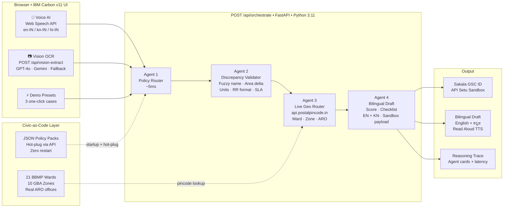

# SevaSync BLR — Speak. Scan. Solve.

> **IBM Bobathon 2026 · Track 01 Agentic AI + Voice AI + Vision OCR**
>
> An agentic AI civic co-pilot that lets any Bengaluru citizen speak a complaint in English, Kannada, or Kanglish, scan a government document with Vision OCR, and receive a fully pre-audited, Sakala-compliant, bilingual application — powered by a live 4-agent reasoning pipeline and hot-pluggable JSON Policy Packs.

---

## How It Works — Speak → Scan → Solve



---

## Quickstart — 2 Terminals

**Prerequisites:** Python 3.11+, Node 18+, repo cloned

### Terminal 1 — Backend (FastAPI on port 8000)

```bash
cd /path/to/sevasync-blr
python3 -m venv .venv && source .venv/bin/activate
pip install -r requirements.txt

cd backend
uvicorn main:app --reload --port 8000
# ✓ SevaSync BLR backend started — 3 policy pack(s) active
# → http://localhost:8000/docs  (Swagger UI)
```

### Terminal 2 — Frontend (Vite + React on port 5173)

```bash
cd /path/to/sevasync-blr/frontend
npm install
npm run dev
# → http://localhost:5173
```

> Open in **Chrome** or **Edge** for Web Speech API microphone support.

### Run Tests (no LLM key required)

```bash
# From repo root, .venv activated
pytest backend/tests/test_agents.py -v
# Expected: 4 passed
```

---

## Data Transparency: Real vs. Sandboxed

| Data / API | Status | Detail |
|---|---|---|
| **Civic rules & SLA days** | ✅ Real | Actual Sakala SLA, BESCOM G.O. DE 48 EEB 2023, BBMP Building Bye-Laws |
| **BBMP ward boundaries** | ✅ Real | 21 wards, 10 GBA zones, correct ARO office names from BBMP Revenue Manual 2024 |
| **PIN → Locality** | ✅ Live API | `api.postalpincode.in` with 3 s timeout; offline fallback to `bengaluru_wards_zones.json` |
| **Citizen PII** | 🔒 Anonymised | Fictitious names/Aadhaar — compliant with DPDP Act 2023 |
| **Government portal writes** | 🧪 API Setu Sandbox | No real BBMP/BESCOM records modified; returns 15-digit Sakala GSC ID |
| **Vision OCR** | ⚡ Key-conditional | GPT-4o (if `OPENAI_API_KEY`) → Gemini (if `GEMINI_API_KEY`) → deterministic fallback |

---

## How We Used IBM Bob

The entire backend was built with **IBM Bob** as the development engine across the hackathon.

**Plan mode** — Bob read `AGENTS.md` and decomposed the work into 8 ordered sub-tasks saved in [`backend-plan.md`](backend-plan.md), each with an explicit Intent, Expected Outcomes, and Todo List. No manual sprint planning needed.

**Agent mode** — Bob executed each sub-task in sequence: Pydantic v2 models, 4-agent pipeline, FastAPI routes, geo resolver with live httpx, vision router with multimodal LLM + fallback, React + IBM Carbon v11 frontend, 21-ward geo JSON, Pillow mock document PNGs, and 4 pytest integration tests — all while reading `AGENTS.md` as a binding contract and refusing to alter shared API key names.

**Result:** `pytest backend/tests/test_agents.py -v` → **4 passed**, zero LLM API key required.

📸 See [`/docs/ibm-bob-workflow/SCREENSHOT_CHECKLIST.md`](docs/ibm-bob-workflow/SCREENSHOT_CHECKLIST.md) for the IBM Bob workflow screenshots.

---

## Five API Endpoints

| Endpoint | Method | Description |
|---|---|---|
| `/api/policies` | GET | List loaded policy packs |
| `/api/policies/register` | POST | Hot-load a new JSON Policy Pack live |
| `/api/vision-extract` | POST | OCR a civic document or return a demo case |
| `/api/orchestrate` | POST | Run the 4-agent pre-flight pipeline |
| `/api/sandbox/submit` | POST | Submit to API Setu sandbox, receive GSC ID |

Full request/response schemas: [`AGENTS.md`](AGENTS.md)

---

## Repository Structure

```
sevasync-blr/
├── AGENTS.md                           # Shared API contracts & folder ownership
├── backend-plan.md                     # IBM Bob Plan mode sub-task tracker
├── requirements.txt
│
├── backend/
│   ├── main.py                         # FastAPI app + PolicyRegistry + all 5 routes
│   ├── agents.py                       # 4-agent sequential pipeline
│   ├── models.py                       # Pydantic v2 models (AGENTS.md contracts)
│   ├── geo.py                          # Live geo resolver (api.postalpincode.in)
│   ├── vision.py                       # Vision OCR router (GPT-4o / Gemini / fallback)
│   └── tests/test_agents.py            # 4 pytest integration tests
│
├── data/
│   ├── real_ground_truth/
│   │   ├── bengaluru_wards_zones.json  # 21 BBMP wards, 10 GBA zones, ARO offices
│   │   ├── policy_pack_ekhata.json     # BBMP e-Khata · SLA 15d
│   │   ├── policy_pack_gruha_jyothi.json # BESCOM Gruha Jyothi · SLA 7d
│   │   └── policy_pack_sakala_sla.json # Sakala Act Oct 2026 · SLA 7d
│   └── sandbox_mocks/
│       ├── policy_pack_eswathu_plugin.json  # Hot-plug demo pack
│       ├── sample_citizen_cases.json        # 3 demo extraction cases
│       ├── generate_mock_docs.py            # Pillow A4 PNG generator
│       └── images/                          # 3 crisp civic document PNGs
│
├── frontend/src/
│   ├── App.tsx                         # 3-column IBM Carbon Grid layout
│   ├── AppHeader.tsx                   # UI Shell + policy tag + register modal
│   ├── SpeakScan.tsx                   # Column 1: Voice + Vision OCR + Run Audit
│   ├── AgentTrace.tsx                  # Column 2: Agent pipeline + discrepancies
│   ├── SolveScale.tsx                  # Column 3: Checklist + bilingual draft + submit
│   └── types.ts                        # TypeScript interfaces (AGENTS.md contracts)
│
└── docs/
    ├── DEMO_RUNBOOK.md                 # Click-by-click 2-minute recording script
    ├── WORKFLOW_AND_PITCH.md           # Mermaid diagram + 7-slide deck + Judge Q&A
    └── ibm-bob-workflow/
        └── SCREENSHOT_CHECKLIST.md    # IBM Bob screenshot checklist
```

---

## Demo Script (5-Minute Live)

| Step | Action | What to Say |
|---|---|---|
| 1 | Click **"e-Khata Mismatch (Mahadevapura)"** preset | *"Vision OCR extracts 8 fields from the document — name mismatch immediately visible"* |
| 2 | Click **"Run 4-Agent Pre-Flight Audit"** | *"4 agents run sequentially — policy router, validator, live geo, bilingual draft"* |
| 3 | Point at teal **"Live India Post API"** badge | *"Agent 3 just called api.postalpincode.in in real time — PIN 560048 maps to BTM Layout, not Koramangala"* |
| 4 | Click **"ಕನ್ನಡ (Kannada)"** tab, then **"Read Aloud"** | *"Kannada draft ready for the citizen to hear and submit"* |
| 5 | Click **"Plug-in New Service"** → **"Load e-Swathu Form 11A JSON"** → **"Register Policy Pack"** | *"Policy count just changed from 3 to 4 — zero code, zero restart — Civic-as-Code"* |

Full 2-minute script: [`/docs/DEMO_RUNBOOK.md`](docs/DEMO_RUNBOOK.md)

---

*Built with IBM Bob · IBM Carbon v11 · FastAPI · React · For 10 million Bengaluru citizens*
*IBM Bobathon 2026 · Track 01 Agentic AI*
