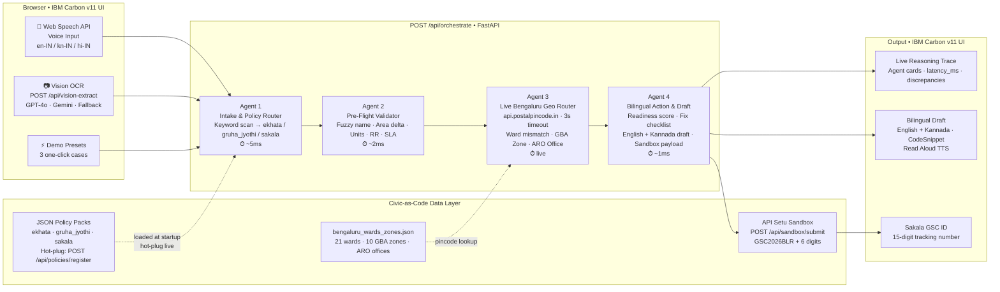

# SevaSync BLR — Workflow Diagram & Pitch Deck

---

## Multimodal Pipeline — Speak → Scan → Solve

---

## 7-Slide Pitch Deck Outline

---

### Slide 1 — Title

**Headline:** SevaSync BLR — Speak. Scan. Solve.

**Sub-headline:** Track 01 Agentic AI · Voice AI · Vision OCR · IBM Bobathon 2026

**Bullets:**
- Agentic AI civic co-pilot for 10 million Bengaluru citizens
- Catches every BBMP, BESCOM & Sakala documentation bug before submission
- Built in one hackathon day — end-to-end — with IBM Bob

**Key metric:** 3 live Bengaluru civic services · 4-agent pipeline · 2-language output

---

### Slide 2 — The Bengaluru Civic Bottleneck

**Headline:** 70% of Bengaluru civic applications are rejected for fixable errors

**Bullets:**
- **BBMP e-Khata mutations** rejected for name abbreviation mismatches ("R. Kumar" vs "Ramesh Kumar S") and built-up area variance > 5%
- **BESCOM Gruha Jyothi subsidy** denied for alpha-numeric RR numbers and consumption > 200 units/month — scheme G.O. DE 48 EEB 2023
- **Sakala Act (Oct 2026 amendment)** mandates escalation to ARO → RO → Deputy Commissioner — but citizens don't know the appeal ladder or the ₹500/day compensation right

**Key metric:** 1,373 services notified under Karnataka Sakala Act — only 3 built today; architecture scales to all 1,373

---

### Slide 3 — Unified Architecture

**Headline:** Speak → Scan → Solve in one seamless pipeline

**Bullets:**
- **Voice AI** — Web Speech API (en-IN / kn-IN / hi-IN) feeds directly into the agent pipeline
- **Vision OCR** — GPT-4o or Gemini Pro Vision extracts 8 fields from real civic documents; deterministic fallback if no API key
- **4-Agent FastAPI Orchestrator** — Policy Router → Discrepancy Validator → Live Geo Router → Bilingual Draft Agent; all sequential, all traceable with latency_ms

**Key metric:** Readiness Score 0–100; "BLOCKED_FIX_REQUIRED" vs "READY_TO_SUBMIT" in < 500ms end-to-end

---

### Slide 4 — Real vs. Sandboxed: 3-Layer Data Transparency

**Headline:** DPDP Act 2023 compliant — real rules, anonymised PII, sandboxed writes

| Layer | Real or Sandbox | Detail |
|---|---|---|
| Civic rules & SLAs | ✅ Real | Actual Sakala SLA days, BESCOM G.O., BBMP Building Bye-Laws |
| Bengaluru ward boundaries | ✅ Real | 21 BBMP wards, 10 GBA zones, correct ARO office names |
| PIN → Locality lookup | ✅ Live API | `api.postalpincode.in` with 3s timeout + offline fallback |
| Citizen PII | 🔒 Anonymised | Fictitious names/Aadhaar — DPDP Act 2023 compliant |
| Government portal writes | 🧪 API Setu Sandbox | No real BBMP/BESCOM records modified |

**Key metric:** Live India Post API called on every orchestration; ward mismatch detected in real-time

---

### Slide 5 — Civic-as-Code Scalability

**Headline:** Add any government service with zero code — just upload a JSON Policy Pack

**Bullets:**
- **3 packs loaded today:** e-Khata, Gruha Jyothi, Sakala Act
- **Live demo:** POST /api/policies/register hot-loads e-Swathu Form 11A with zero server restart; policy count tag increments from 3 → 4 live on screen
- **Path to 1,373 services:** Every Karnataka Sakala-notified service can be expressed as a JSON Policy Pack; each pack contains bilingual draft templates, Pydantic-validated rules, and API Setu endpoints

**Key metric:** 1 JSON file = 1 new civic service; no backend code change required

---

### Slide 6 — Built with IBM Bob & IBM Carbon

**Headline:** From AGENTS.md contract to 4 passing pytest tests in one Bobathon day

**Bullets:**
- **Plan mode:** Bob read AGENTS.md, decomposed the backend into 8 ordered sub-tasks, wrote `backend-plan.md` as the authoritative tracker — no manual sprint planning
- **Agent mode:** Bob generated `main.py`, `agents.py`, `models.py`, `geo.py`, `vision.py`, 3 policy packs, 21-ward geo JSON, Pillow mock document PNGs, and 4 pytest tests — enforcing the shared API contract on every file
- **IBM Carbon v11:** Complete `@carbon/react` UI Shell — Header, Grid, Tabs, CodeSnippet, ProgressBar, InlineNotification — zero Tailwind, zero custom CSS frameworks

**Key metric:** `pytest backend/tests/test_agents.py -v` → `4 passed` with zero LLM API key

---

### Slide 7 — Measurable Impact & Team

**Headline:** Civic AI that works for the citizen, not just the engineer

**Bullets:**
- **10M+ Bengaluru citizens** impacted by BBMP, BESCOM, and Sakala services annually
- **Bilingual output** in English + Kannada with one-click Read Aloud — accessible to non-English speakers
- **Oct 2026 Sakala Act compliance** built-in — ₹500/day penalty on defaulting officers cited in every escalation draft

**Team:**
| Role | Deliverable |
|---|---|
| Dev 1 — Backend | `main.py`, `agents.py` |
| Dev 2 — AI & Integrations | `vision.py`, `geo.py` |
| Dev 3 — Frontend | `frontend/` (IBM Carbon) |
| Dev 4 — Civic Data | `data/` (policy packs, ward JSON, mock PNGs) |
| Dev 5 — Documentation | `docs/`, `README.md` |

**Key metric:** Entire stack runnable in 3 commands, offline, with no paid API key

---

## Judge Q&A Cheat Sheet

---

**Q1: Is the data live or mocked?**

> The civic *rules* (Sakala SLA days, BESCOM 200-unit ceiling, BBMP ward boundaries) are sourced from real government orders. The PIN-to-locality lookup calls `api.postalpincode.in` live with a 3-second timeout and falls back gracefully. Citizen PII in demo cases is fully anonymised. Government portal *writes* go to the API Setu sandbox — no real BBMP or BESCOM records are modified.

---

**Q2: How does this scale beyond Bengaluru?**

> The entire validation and routing logic lives in JSON Policy Packs, not in Python code. Any Karnataka Sakala-notified service (all 1,373 of them) or any Indian government service with a defined SLA can be expressed as one JSON file and hot-loaded via POST /api/policies/register with zero server restart. The geo resolver already handles any Indian PIN via `api.postalpincode.in`, and the bilingual draft templates are parameterised — adding a new language requires adding a template key to the JSON, not changing any backend code.

---

**Q3: How was IBM Bob used?**

> IBM Bob's Plan mode read `AGENTS.md` and produced a structured `backend-plan.md` with 8 sub-tasks, each with Intent, Expected Outcomes, and an ordered Todo List — replacing a full sprint planning session. Agent mode then executed each sub-task sequentially: generating Pydantic models, the 4-agent pipeline, the FastAPI routes, the React components, the ward JSON, the Pillow mock documents, and the pytest suite — all while enforcing the shared API contract defined in AGENTS.md. The result was a fully working, tested backend in one day.

---

**Q4: Why combine Voice, Vision, and Agentic AI?**

> These three modalities solve three different access barriers. Voice (Web Speech API) removes the literacy barrier — a citizen in Kannada can speak their complaint without typing. Vision OCR removes the transcription barrier — a citizen can photograph their government document instead of re-keying every field. Agentic AI removes the expertise barrier — the citizen doesn't need to know which BBMP rule applies or what the Sakala appeal ladder looks like. All three barriers compound in real civic interactions; solving only one or two leaves the citizen stuck. Together, they deliver a single seamless experience: Speak → Scan → Solve.
